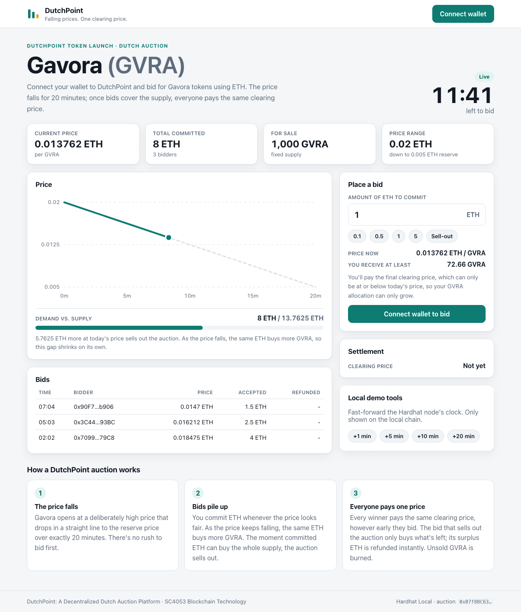

# DutchPoint

**DutchPoint: A Decentralized Dutch Auction Platform** - *Falling prices. One clearing price.*

DutchPoint launches the **Gavora (GVRA)** ERC20 token through a 20-minute uniform-price Dutch auction on
Ethereum. Connect your wallet to DutchPoint and bid for Gavora tokens using ETH:

- the price falls in a straight line from a high start price to a reserve price over exactly 20 minutes;
- bidders commit ETH whenever the price looks fair, and as the price keeps falling the same ETH buys more GVRA;
- the moment committed ETH can buy the whole supply, the auction sells out. The bid that crosses the
  line only buys what is left, and its surplus ETH is refunded in the same transaction;
- every winner pays the **same clearing price**, however early they bid;
- if the window ends first, everyone pays the reserve price and unsold GVRA is **burned**.

SC4053 Blockchain Technology, AY2026-27 Semester 1 - Development Project, Option 2.



## Quick start (local)

Requirements: Node.js 22+ and MetaMask (or another browser wallet).

```bash
npm install
npm run node            # terminal 1: local chain on 127.0.0.1:8545, mines a block every 2 s
npm run deploy:local    # terminal 2: deploys GavoraToken + DutchAuction and starts the auction
npm run dev             # terminal 2: http://127.0.0.1:5173
```

Optional: `npm run seed:local` places three bids from test accounts, so the dashboard has history.

**MetaMask:** open the app and click *Connect wallet*. If prompted, let the app add the
**Hardhat Local** network (RPC `http://127.0.0.1:8545`, chain ID `31337`). Import one of the private keys
printed by `npm run node`; these are public test keys - never use them elsewhere. After restarting the
node, use MetaMask's *Settings → Advanced → Clear activity tab data* so nonces reset.

**Skipping time in a demo:** the *Local demo tools* card (shown only on the local chain) moves the
chain clock forward 1-20 minutes. The command-line equivalent is `ADVANCE_SECONDS=600 npm run time:advance`.

## Deterministic demo

```bash
npm run demo
```

It runs five scenarios on an in-process chain and prints the results:
1. a sale that clears early, with the crossing bid's surplus refunded automatically;
2. an undersubscribed sale settling at reserve, with unsold GVRA burned;
3. a contract bidder that rejects ETH and keeps its refund as a withdrawable credit;
4. a reentrancy attack draining a deliberately vulnerable auction;
5. the same attack failing against DutchPoint.

The narrated video plan is in [`docs/demo/demo-script.md`](docs/demo/demo-script.md).

## Testing and security

| Command | What it runs |
| --- | --- |
| `npm test` | All 53 tests: 46 Mocha tests, plus 3 Solidity fuzz tests (1,000 runs each) and 4 invariants (256 runs, depth 50) |
| `npm run gas` | Gas-scaling table (each call costs the same with 1 or 100 earlier bidders) and per-function gas statistics |
| `npm run coverage` | Same, with coverage - `DutchAuction.sol` and `GavoraToken.sol` are at 100% lines and statements |
| `npm run slither` | Slither static analysis; fails on any Medium or High finding (needs `slither-analyzer` and `solc` 0.8.28) |
| `npm run typecheck` / `npm run build` | Frontend and script type checks; production build |

Install Slither with `uv tool install --python 3.12 slither-analyzer` (or `pip install slither-analyzer`), then
`solc-select install 0.8.28 && solc-select use 0.8.28`.

CI (`.github/workflows/ci.yml`) runs all of the above on every push and pull request.

## Optional: Sepolia testnet

Not needed for testing or the demo. A public deployment adds Etherscan links as evidence.

```bash
npm run keystore -- set SEPOLIA_RPC_URL        # e.g. an Alchemy/Infura Sepolia URL
npm run keystore -- set SEPOLIA_PRIVATE_KEY    # a throwaway wallet holding Sepolia test ETH
npm run keystore -- set ETHERSCAN_API_KEY      # only for source verification
npm run deploy:sepolia
```

The script prints Etherscan links and verification commands, and records addresses and transaction
hashes in `deployments/sepolia.json`. To have the frontend default to Sepolia, set
`VITE_DEFAULT_CHAIN_ID=11155111` (and optionally `VITE_READ_RPC_URL`) in `.env`. `START_AUCTION=false`
deploys without starting, so the issuer can start the 20-minute window from the UI later.

## Project structure

```text
contracts/                   On-chain code
  GavoraToken.sol            ERC20 "Gavora" (GVRA): fixed supply, burnable, no owner, no mint
  DutchAuction.sol           The auction engine
  mocks/                     Test-only: ReentrancyAttacker, RejectingReceiver,
                             VulnerableAuction (deliberately vulnerable)
test/
  DutchAuction.test.ts       Scenario and unit tests
  AuditRegressions.test.ts   Regression tests for audit findings F1-F4
  Reentrancy.test.ts         Vulnerable vs. secure reentrancy demonstration
  GavoraToken.test.ts        Token tests
  solidity/                  Fuzz and invariant tests (forge-std)
scripts/                     deploy, demo, seed-local, advance-time, poc-crowd-out
frontend/                    Off-chain code: the React + Vite dApp
  index.html, vite.config.ts
  src/                       components/, hooks/, lib/, generated/ (ABIs and addresses)
docs/
  ai-audit/                  AI Audit Report, development log, evidence/, prompts/
  design/                    Spec, architecture, assumptions, requirements checklist
  demo/                      Demo script, screenshots/
```

Everything installs with one `npm install` at the root; every command runs from the root.

## How the contracts work

- **`GavoraToken`** mints its whole supply once to the deployer, who transfers the sale supply into the
  auction. There is no mint function and no owner, so the supply can only go down (by burning).
- **`DutchAuction`**:
  - `start()` (issuer only) opens the 20-minute window.
  - `contribute()` / plain ETH transfers place bids.
  - `finalize()` (anyone, after the window) fixes the price and burns unsold GVRA.
  - `claimTokens()` pays each bidder `commitment / finalPrice` GVRA.
  - `withdrawRefundTo()` is a fallback for refunds a bidder contract rejected.
  - `withdrawIssuerProceeds()` (issuer only) withdraws the sale revenue.
  - `burnRemainderAfterAllClaimed()` burns rounding dust.
- There are no loops over bidders. Refunds follow checks-effects-interactions behind `ReentrancyGuard`.
- The maths, including the exact clearing price when time alone clears the auction, is in
  [`docs/design/spec.md`](docs/design/spec.md).

## Documentation

| Document | Contents |
| --- | --- |
| [`docs/ai-audit/report.md`](docs/ai-audit/report.md) | **AI Audit Report** (8 sections, findings F1-F6 with evidence, and an appendix linking the design to the lectures) |
| [`docs/ai-audit/evidence/`](docs/ai-audit/evidence/) | Before/after test logs, PoC output, mutation check, coverage, Slither |
| [`docs/ai-audit/prompts/`](docs/ai-audit/prompts/README.md) | Prompt logs for ChatGPT, Codex and Claude Code |
| [`docs/design/spec.md`](docs/design/spec.md) | Requirements and auction mathematics |
| [`docs/design/architecture.md`](docs/design/architecture.md) | Contract, frontend and test architecture |
| [`docs/design/assumptions.md`](docs/design/assumptions.md) | Interpretations of ambiguous requirements and questions for the TA |
| [`docs/design/requirements-checklist.md`](docs/design/requirements-checklist.md) | Requirement → implementation → test |
| [`docs/demo/demo-script.md`](docs/demo/demo-script.md) | Under-10-minute demo plan |
| [`docs/ai-audit/development-log.md`](docs/ai-audit/development-log.md) | Chronological AI development log |

## Team

**TODO (team):** names, matriculation numbers and responsibilities.
